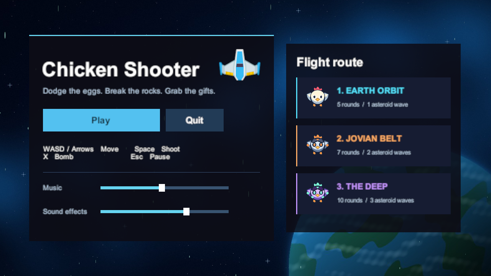
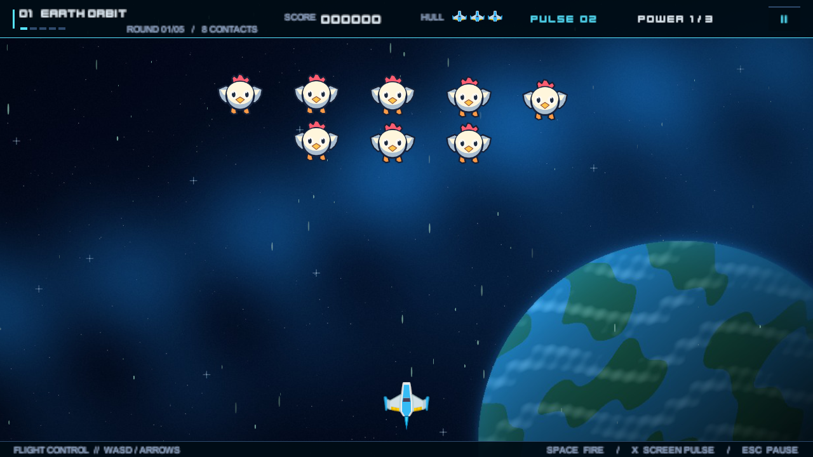
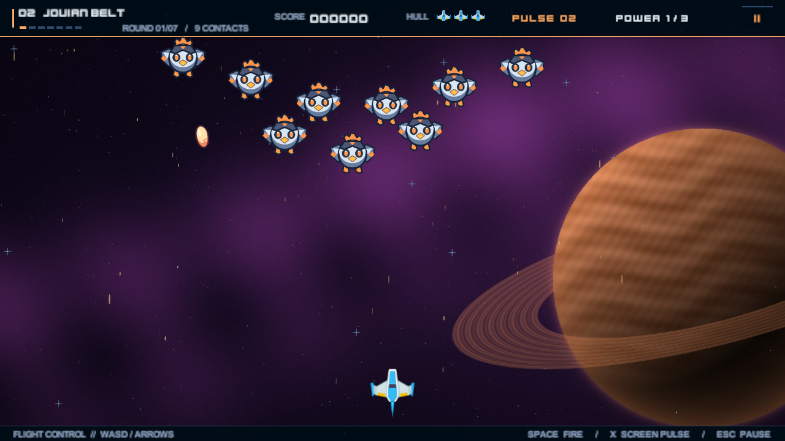
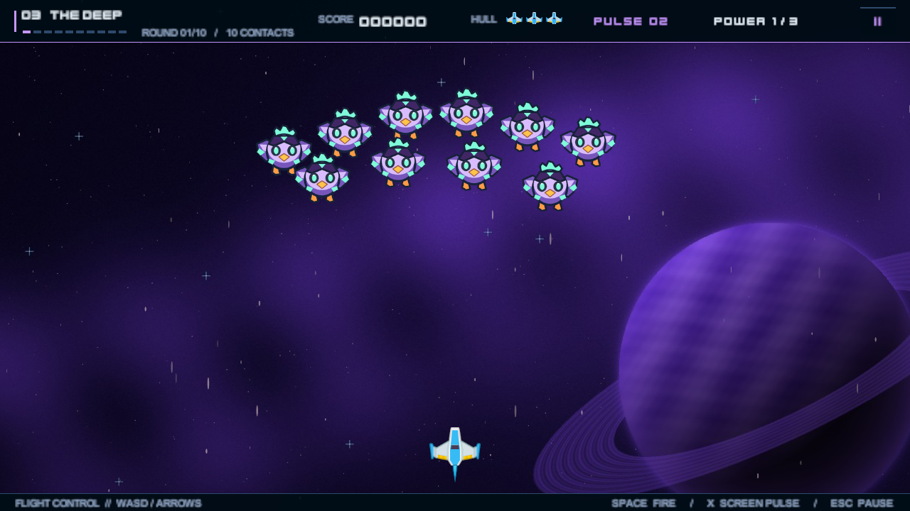

# گزارش کار تمرین سوم — Chicken Shooter

## هدف و وضعیت پروژه

Chicken Shooter یک بازی تیراندازی دوبعدی از نمای بالا است که با **Unity 6000.6.4f1** ساخته شده است. بازیکن یک سفینه را در سه مرحله هدایت می‌کند و برای پیشروی باید موج‌های مرغ مهاجم و شهاب‌سنگ را پشت سر بگذارد. بازی از منوی اصلی شروع می‌شود و مجموعاً **۲۲ راند** دارد. این گزارش پیاده‌سازی فاز اول و تکمیل صدا و منو را شرح می‌دهد. ذخیرهٔ پیشرفت در JSON و باس‌فایت‌ها در این نسخه پیاده نشده‌اند. طراحی آن‌ها در دو بخش جدا آمده است.

## روند انجام کار

1. **ساخت صحنه‌ها و داده‌ها.** ابتدا منوی اصلی و سه صحنهٔ گیم‌پلی ساخته شدند. برای اینکه تغییر سختی و ترتیب موج‌ها به تغییر کد احتیاج نداشته باشد، تنظیمات مرحله، راند و سلاح به دارایی‌های ScriptableObject منتقل شدند.
2. **کنترل سفینه و مبارزه.** اکشن‌های حرکت، شلیک، بمب و توقف در New Input System تعریف شدند. سپس محدودهٔ حرکت، برخوردهای دوبعدی، سه سطح قدرت لیزر و مصونیت کوتاه بعد از دریافت ضربه اضافه شدند.
3. **موج‌ها و رفتار دشمنان.** ابتدا ورود از بالای تصویر و آرایش گروهی ساخته شد. بعد تخم‌گذاری، شیرجهٔ هشدار‌دار، بازگشت مرغ‌ها به صف و موج‌های شهاب‌سنگ به همین چرخه اضافه شدند.
4. **پیشروی و حفظ آمار.** مدیریت آغاز و پایان راند، انتقال خودکار بین مراحل، تلاش مجدد و صفحهٔ پیروزی به جریان صحنه اضافه شد. وضعیت بازیکن در یک مدیر سراسری قرار گرفت تا با تعویض صحنه از بین نرود.
5. **تنظیم سختی، ظاهر و صدا.** جان مرغ و فاصلهٔ تخم‌گذاری به تنظیمات مرحله اضافه شد. برای مرغ و سنگ ظاهر آسیب‌دیده طراحی شد. منو، پس‌زمینه‌ها، موسیقی و افکت‌های صوتی تکمیل شدند و خروجی ویندوز ساخته شد.

## معماری و مسئولیت کلاس‌ها

| بخش | فایل یا کلاس | مسئولیت |
| --- | --- | --- |
| جریان صحنه و راند | `SceneEntry` | راه‌اندازی صحنه، مکث، پیام شروع راند، پایان مرحله، شکست و پیروزی |
| وضعیت بازیکن | `GameManager` | نگه‌داری آمار، تغییر راند، بارگذاری صحنه و اعلام تغییرات |
| شبیه‌سازی مبارزه | `Arena` و `PlayerShip` | ایجاد و حرکت دشمنان، حرکت و شلیک سفینه، برخوردها و مصرف بمب |
| آرایش دشمنان | `FormationMath` | محاسبهٔ جای هر مرغ در آرایش و نقطهٔ فعلی روی منحنی ورود |
| بازیافت آبجکت‌ها | `BodyPool` و `PoolBody` | آماده‌سازی، فعال‌سازی و بازگرداندن نمونه‌های هر پری‌فب |
| رابط و صدا | `MainMenuPanel`، `ArcadeView` و `GameAudio` | اتصال دکمه‌های منو، نمایش وضعیت بازی، پخش موسیقی و افکت‌ها |

رابط کاربری مالک امتیاز یا جان بازیکن نیست. برای نمونه، هنگام برخورد، `GameManager.TakeHit` تعداد جان‌ها را به‌روزرسانی می‌کند. رویداد `Damaged` به سفینه خبر می‌دهد که زمان مصونیت را آغاز کند و رویداد `Changed` نمایش جان و قدرت سلاح را به‌روز می‌کند. به همین شکل تغییر راند، امتیاز و سطح سلاح رویدادهای مشخص خودشان را دارند.

## مدیریت صحنه‌ها و انتقال آمار

چهار صحنه در Build Settings ثبت شده‌اند و `MainMenu` اولین صحنهٔ خروجی است. ترتیب بازی `MainMenu → Level1 → Level2 → Level3` است. منو و صفحه‌های توقف، شکست و پیروزی از رابط داخل صحنه استفاده می‌کنند. برای پیام بین مراحل صحنهٔ جداگانه لازم نیست.

در اولین ورود به بازی، `GameManager.Get` یک نمونه از مدیر بازی می‌سازد و روی آن `DontDestroyOnLoad` را اجرا می‌کند. هنگام ورود به صحنهٔ بعد همان نمونه برگردانده می‌شود. **شمارهٔ مرحله، شمارهٔ راند، جان، امتیاز، تعداد بمب و سطح سلاح** در این نمونه قرار دارند.

- انتخاب **Play** راند اول مرحلهٔ ۱ را با ۳ جان، ۲ بمب، امتیاز صفر و سلاح پایه آغاز می‌کند.
- `SceneEntry` در شروع راند پیام معرفی را نشان می‌دهد و سپس راند را در `Arena` فعال می‌کند. وقتی همهٔ هدف‌های راند تعیین تکلیف شدند، راند بعدی شروع می‌شود. در موج سنگی، عبور سالم سنگ از پایین صفحه هم از تعداد هدف‌های باقی‌مانده کم می‌کند.
- در پایان آخرین راند، پیام اتمام مرحله نمایش داده می‌شود. `GameManager.AdvanceStage` شمارهٔ مرحله را افزایش می‌دهد و راند را روی ۱ می‌گذارد. نام صحنه از `LevelDataSO.sceneName` خوانده می‌شود و به `SceneManager.LoadScene` می‌رسد. جان، امتیاز، بمب و سطح سلاح در این انتقال حفظ می‌شوند.
- با صفر شدن جان، صفحهٔ شکست باز می‌شود. **Retry Sector** همان مرحله را از راند ۱ با منابع اولیه شروع می‌کند. پاک‌سازی مرحلهٔ سوم صفحهٔ پیروزی و امتیاز نهایی را نمایش می‌دهد.

حفظ آمار بین صحنه‌ها در حافظه انجام می‌شود. با پایان اجرای برنامه، وضعیت این دور بازی از بین می‌رود. مقدارهای بلندی موسیقی و افکت‌ها جداگانه در `PlayerPrefs` نگه داشته می‌شوند.

## تعریف مرحله، راند و سلاح

**`CampaignDataSO`** فهرست مراحل، سه سطح سلاح، اکشن‌های ورودی، پری‌فب‌های مشترک و افکت‌های صوتی را به هم وصل می‌کند. صحنه از همین دارایی به تنظیمات مورد نیاز خود دسترسی دارد.

**`LevelDataSO`** شمارهٔ مرحله، نام صحنه، رنگ تم، پس‌زمینه، موسیقی و آرایهٔ مرتب راندها را نگه می‌دارد. گزینهٔ **Use Level Difficulty** اجازه می‌دهد **Hits to Defeat** و **Seconds Between Egg Drops** برای همهٔ موج‌های مرغ آن مرحله مشترک باشند. با خاموش کردن آن، جان و فاصلهٔ تخم‌گذاری از دادهٔ هر موج خوانده می‌شوند.

**`WaveDataSO`** نوع موج، پری‌فب هدف، تعداد، جان، فاصلهٔ ورود، سرعت و الگوی آرایش را تعیین می‌کند. برای موج مرغ، فاصله و سرعت تخم‌ها، خم مسیر ورود و تنظیمات شیرجه هم در همین دارایی هستند. در موج شهاب‌سنگ، **Target Count** و **Health** مستقیماً تعداد و جان سنگ‌های همان موج را تغییر می‌دهند. برای ویرایش، در منوی Unity به **Cluck Defender → Difficulty** بروید، مرحله را انتخاب کنید و از فهرست **Rounds** موج مورد نظر را باز کنید.

**`WeaponDataSO`** پری‌فب تیر، قدرت هر ضربه، سرعت، نرخ شلیک و مسیرهای پرتاب را مشخص می‌کند. سه دارایی سلاح به‌ترتیب یک لیزر، دو لیزر موازی و سه لیزر پخش‌شونده دارند.

| مرحله | آرایش مرغ‌ها | تعداد راند | راندهای شهاب‌سنگ | تعداد سنگ در موج‌ها | جان پیش‌فرض سنگ |
| --- | --- | --- | --- | --- | --- |
| مدار زمین | شبکه‌ای | ۵ | ۳ | ۱۳ | ۱ |
| کمربند مشتری | زاویه‌دار | ۷ | ۳ و ۵ | ۱۵ و ۱۴ | ۲ |
| اعماق کهکشان | فشرده و لوزی | ۱۰ | ۳، ۵ و ۷ | ۱۶، ۱۸ و ۲۰ | ۳ |

## ورودی، مبارزه و رفتار دشمنان

سفینه با **WASD یا کلیدهای جهت‌نما** حرکت می‌کند و در محدودهٔ تصویر نگه داشته می‌شود. **Space** با فشار کوتاه یا نگه‌داشتن شلیک می‌کند. **X** بمب را فعال می‌کند و **Esc** بازی را متوقف یا ادامه می‌دهد. کنترل دسته هم برای حرکت، شلیک، بمب و توقف تعریف شده است.

برخوردها با Collider و Rigidbody دوبعدی تشخیص داده می‌شوند. بعد از آسیب، یک جان و در صورت امکان یک سطح سلاح کم می‌شود. سفینه حدود **۱٫۶۵ ثانیه** مصونیت دارد و با سپر و چشمک این وضعیت را نشان می‌دهد. کادو سطح سلاح را تا ۳ بالا می‌برد و در سطح آخر امتیاز می‌دهد. بمب مرغ‌های حاضر در برد را حذف می‌کند و وقتی مرغی در برد نباشد مصرف نمی‌شود. لیزر از تخم‌ها رد می‌شود، تخم‌ها با بمب هم باقی می‌مانند و بازیکن باید از آن‌ها جاخالی بدهد.

مرغ‌ها از بالای تصویر وارد منحنی می‌شوند و جای خود را در آرایش می‌گیرند. مرغ در صف می‌تواند تخم بیندازد. مرغی که برای شیرجه انتخاب شده ابتدا تغییر رنگ و لرزش کوتاه دارد، سپس به سمت موقعیت سفینه حرکت می‌کند. اگر از شیرجه جان سالم به در ببرد، دوباره وارد مسیر صف می‌شود. ظاهر آسیب مرغ بعد از از دست دادن یک‌چهارم، نصف و سه‌چهارم جان عوض می‌شود. برای مرغی با ۸ جان، این تغییرها بعد از ضربه‌های دوم، چهارم و ششم رخ می‌دهند.

سنگ‌ها از مسیرهای مختلف می‌آیند و در سقوط می‌چرخند. سنگی که بعد از ضربهٔ اول هنوز جان داشته باشد ترک می‌خورد. بعد از ضربهٔ دوم، اگر باقی بماند، ظاهر شکاف‌دار می‌گیرد. سنگی که جانش صفر شود فوراً با ذره و صدا می‌شکند.

## تصویر، رابط و صدا

هر مرحله یک پس‌زمینه و رنگ تم جدا دارد. کلاس `Backdrop` لایهٔ ثابت پس‌زمینه را کنار ستاره‌هایی با چند سرعت حرکت قرار می‌دهد. هنگام ضربه یا انفجار، تغییر رنگ، ذرات و لرزش کوتاه دوربین نتیجهٔ برخورد را نشان می‌دهند. رابط بازی تعداد هدف‌های باقی‌مانده، شمارهٔ راند، امتیاز، جان، بمب و سطح سلاح را نمایش می‌دهد.

`GameAudio` در هر صحنه دو `AudioSource` می‌سازد. یکی قطعهٔ همان صحنه را تکرار می‌کند و دیگری افکت‌های کوتاه شلیک، آسیب، انفجار، کادو و اتمام راند را پخش می‌کند. برای افکت‌های پرتکرار مثل شلیک، حداقل فاصلهٔ زمانی در نظر گرفته شده تا صداها در یک لحظه روی هم انباشته نشوند. تنظیم بلندی هر مسیر از منوی اصلی جداست.

## بازیافت آبجکت‌ها

`Arena` برای هر صحنه یک `BodyPool` دارد. به‌جای ساختن و نابود کردن مداوم تیر، تخم، مرغ، سنگ، کادو و ذره، برای هر پری‌فب یک مجموعهٔ جدا از نمونه‌های غیرفعال آماده می‌شود.

1. ابتدای مرحله، `Warm` تعدادی نمونه از پری‌فب‌های مورد نیاز را از قبل می‌سازد.
2. `Spawn` یک نمونه را از مجموعه برمی‌دارد و فعال می‌کند. `PoolBody.Activate` داده‌های قبلی مثل جان، ظاهر، زمان عمر، سرعت و چرخش را پاک می‌کند تا نمونه با وضعیت تازه وارد بازی شود.
3. پس از برخورد، پایان عمر یا خروج از محدوده، `Release` نمونه را غیرفعال می‌کند و به مجموعهٔ همان پری‌فب برمی‌گرداند. برای حذف از فهرست فعال، آخرین نمونه جای نمونهٔ حذف‌شده را می‌گیرد تا نیازی به جابه‌جایی بقیهٔ فهرست نباشد.

اگر مجموعه خالی شود نمونهٔ تازه ساخته می‌شود. آبجکت‌های هر صحنه همراه همان صحنه از بین می‌روند و آمار بازیکن جداگانه در `GameManager` حفظ می‌شود.

## طرح ذخیرهٔ JSON برای فاز دوم

قالب زیر **پیشنهاد پیاده‌سازی فاز دوم** است. در آن شمارهٔ مرحله و راند از ۱ شروع می‌شوند و `version` امکان تغییر قالب را در نسخه‌های بعدی فراهم می‌کند.

```json
{
  "version": 1,
  "levelIndex": 2,
  "roundIndex": 4,
  "score": 2175,
  "lives": 2,
  "bombs": 1,
  "weaponPower": 2,
  "foodProgress": 30
}
```

پیشنهاد این است که یک کلاس دادهٔ قابل سریال‌سازی اطلاعات بالا را از `GameManager` بگیرد. `JsonUtility` آن را به متن تبدیل می‌کند و فایل `savegame.json` در `Application.persistentDataPath` قرار می‌گیرد. ابتدا فایل موقت در همان مسیر نوشته می‌شود و بعد از کامل شدن نوشتن، جای فایل اصلی را می‌گیرد. در زمان خواندن، نسخهٔ قالب، بازهٔ مرحله و راند و مقدارهای آمار بررسی می‌شوند.

ذخیرهٔ خودکار بعد از مشخص شدن **راند بعدی** انجام می‌شود. موقعیت مرغ‌ها و تیرهای فعال در فایل ثبت نمی‌شوند و Continue راند ذخیره‌شده را از ابتدای آن اجرا می‌کند. پس از انتخاب Continue، ابتدا آمار به `GameManager` داده می‌شود و سپس صحنه با نام موجود در دارایی مرحله باز می‌شود. در زمان باخت، ذخیره روی راند ۱ همان مرحله و وضعیت اولیهٔ تلاش مجدد قرار می‌گیرد. در پیروزی نهایی فایل پاک می‌شود تا اجرای بعدی با یک دور تازه آغاز شود.

## طرح ماشین حالت باس‌ها برای فاز دوم

ماشین حالت فعلی `SceneEntry` جریان **معرفی راند، مبارزه، اتمام مرحله، شکست و پایان** را مدیریت می‌کند. ماشین حالت زیر **طرح پیشنهادی مستقل برای رفتار باس** است. در نسخهٔ فعلی، آخرین موج عادی پایان مرحله را تعیین می‌کند.

| حالت باس | رفتار | شرط گذار |
| --- | --- | --- |
| ورود | ورود از بالای تصویر و نمایش نوار جان | رسیدن به محل شروع نبرد |
| تخم‌باران | شلیک خوشه‌ای با فاصلهٔ مشخص | پایان الگو یا رسیدن به آستانهٔ خشم |
| شیرجه | هشدار دیداری، حرکت به‌سوی سفینه و پرتاب پر انرژی | پایان حرکت و بازگشت به تخم‌باران |
| خشم | شلیک سریع‌تر و احضار مرغ‌های کوچک | فعال شدن در کمتر از ۳۰٪ جان و ادامه تا شکست |
| شکست باس | توقف حمله، پاک‌سازی هدف‌های باقی‌مانده و ثبت امتیاز | فعال کردن روند پایان مرحله یا پیروزی نهایی |

برای پیاده‌سازی می‌توان از یک `enum` و متدهای جدا برای ورود و به‌روزرسانی هر حالت استفاده کرد. جان، سرعت، نرخ حمله و تعداد مرغ‌های کمکی هر باس می‌توانند در یک دارایی دادهٔ جدا تنظیم شوند. بمب در این طراحی مرغ‌های کمکی را حذف می‌کند و به خود باس حدود **۱۸٪ از جان کامل** آسیب می‌زند. بعد از شکست باس، روند فعلی پیام اتمام مرحله و انتقال با `SceneManager.LoadScene` قابل استفاده است.

## تصاویر بازی

**شکل ۱. منوی اصلی بازی.** مسیر مراحل در سمت راست و تنظیم جداگانهٔ موسیقی و افکت‌ها در سمت چپ دیده می‌شود.



**شکل ۲. مدار زمین.** مرغ‌ها در آرایش شبکه‌ای وارد می‌شوند. بالای تصویر شمارهٔ راند، امتیاز، جان، بمب و سطح سلاح نمایش داده شده‌اند.



**شکل ۳. کمربند مشتری.** مرغ‌های زرهی و تم گرم مرحلهٔ دوم از مرحلهٔ اول متمایز هستند.



**شکل ۴. اعماق کهکشان.** مرغ‌های سایبری در آرایش فشرده با تم بنفش مرحلهٔ سوم دیده می‌شوند.



## خروجی و نحوهٔ اجرا

- **خروجی ویندوز:** فایل `Cluck Defender.exe` در پوشهٔ `Builds/Phase1-Windows` قرار دارد. برای اجرا روی سیستم دیگر، کل پوشهٔ خروجی را با هم منتقل کنید.
- **اجرا در Unity:** پوشهٔ پروژه را با Unity 6000.6.4f1 باز کنید و از صحنهٔ `Assets/Scenes/MainMenu.unity` دکمهٔ Play را بزنید. منو به‌صورت Canvas در صحنه قرار دارد و عنوان، دکمه‌ها و اسلایدرها از Hierarchy قابل ویرایش‌اند.
- **ساخت دوبارهٔ خروجی:** از دستور **Cluck Defender → Build Phase 1 for Windows** در منوی Unity استفاده کنید.

سفینه، سپر، سنگ سالم و فونت نمایشی از مجموعهٔ Space Shooter Redux با مجوز CC0 هستند. اسپرایت‌های مرغ، سنگ آسیب‌دیده، پس‌زمینه‌ها، موسیقی و افکت‌های صوتی برای پروژه تهیه شده‌اند. [منبع دارایی‌های Kenney](https://lpc.opengameart.org/content/space-shooter-redux)
